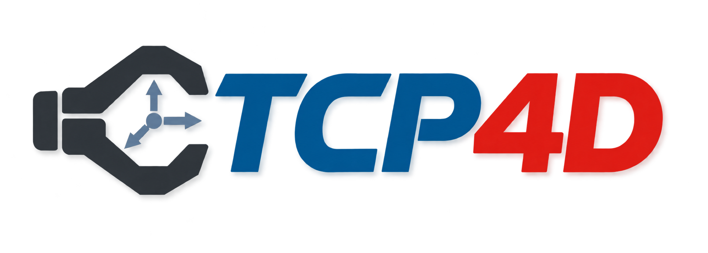
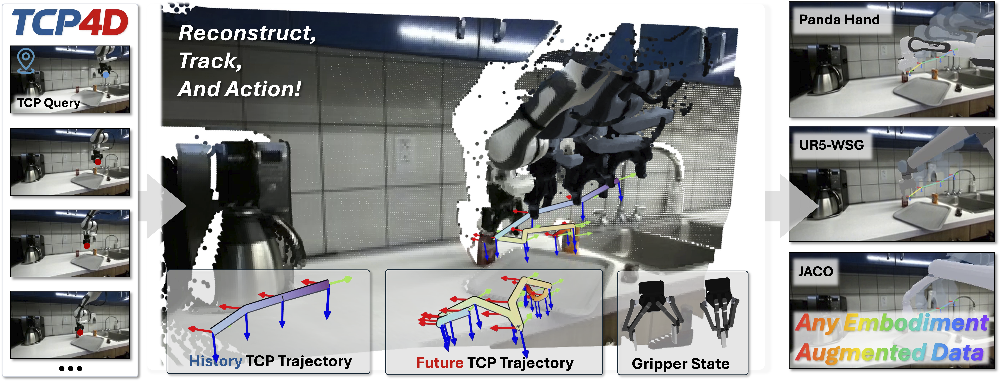
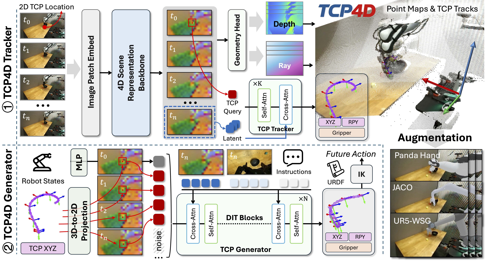

<div align="center">

  

  <h1>TCP4D: A Unified Tool-Center-Point Tracking and Generation Model for Robot Manipulation</h1>

  <!-- TODO: Replace the remaining #resources href values with the Paper, Dataset, Model and Page URLs. -->
  <a href="#resources" title="Paper: coming soon"></a>
  <a href="https://huggingface.co/collections/HarrisonPENG/tcp4d-datasets-and-benchmark" title="Dataset"></a>
  <a href="https://huggingface.co/datasets/HarrisonPENG/TCP4D-Benchmark" title="TCP4D Benchmark on Hugging Face"></a>
  <a href="https://huggingface.co/collections/HarrisonPENG/tcp-4d-models" title="TCP4D Model on Hugging Face"></a>
  <a href="https://creativecommons.org/licenses/by/4.0/" title="Code and models: CC BY 4.0"></a>
  <a href="https://livioni.github.io/TCP4D/" title="Project-Page"></a>

</div>

---

<div align="center">
  
</div>

<p align="center"><em>TCP4D reconstructs scenes, tracks TCP poses and gripper states, predicts future TCP trajectories, and supports cross-embodiment data augmentation.</em></p>


## 🧭 Overview

**TCP4D** shares a 4D scene representation between its **Tracker** and **Generator**. The tracker recovers metric TCP poses, gripper states, scene geometry and camera parameters from RGB videos and initial 2D TCP queries. The generator samples features along the recovered tracks and combines them with current robot observations and language to generate future TCP trajectories. The paper also introduces a cross-embodiment augmentation pipeline that retargets recovered motion and synthesizes target-robot observations.

<div align="center">
  
</div>


## 🛠️ Installation

Run commands from the repository root. The tested stack is Python 3.11, PyTorch 2.9.1 + CUDA 12.8, torchvision 0.24.1, Transformers 4.55.4 and Accelerate 1.10.1.

```bash
git clone https://github.com/Livioni/TCP4D.git
cd TCP4D
conda create -n tcp4d python=3.11 -y
conda activate tcp4d

# Install a matching PyTorch / torchvision pair first.
python -m pip install torch==2.9.1 torchvision==0.24.1 \
  --index-url https://download.pytorch.org/whl/cu128
python -m pip install -e '.[visualization]'
```

## 📥 Download Checkpoints and Datasets

Released assets are listed in the Hugging Face [model collection](https://huggingface.co/collections/HarrisonPENG/tcp-4d-models) and [dataset and benchmark collection](https://huggingface.co/collections/HarrisonPENG/tcp4d-datasets-and-benchmark). 

### 📖 Checkpoints

| Checkpoint | Usage | Local directory |
| --- | --- | --- |
| [TCP4D-stage1-DROID](https://huggingface.co/HarrisonPENG/TCP4D-stage1-DROID) | Single-arm TCP4D tracking trained on DROID | `checkpoints/TCP4D-stage1-DROID/` |
| [TCP4D-stage1-RoboTwin](https://huggingface.co/HarrisonPENG/TCP4D-stage1-RoboTwin) | Dual-arm  TCP4D tracking trained on RoboTwin; Stage2 initialization | `checkpoints/TCP4D-stage1-RoboTwin/` |
| [TCP4D-stage2-RoboTwin](https://huggingface.co/HarrisonPENG/TCP4D-stage2-RoboTwin) | Dual-arm action generation with a 32-step prediction horizon | `checkpoints/TCP4D-stage2-RoboTwin/` |

### 🗂️ Datasets and benchmark

| Dataset | Published layout | Local directory |
| --- | --- | --- |
| [DROID Training Set](https://huggingface.co/datasets/HarrisonPENG/TCP4D-DROID-Training-Set) | 33,966 episodes in 1,018 TAR shards, with episode and shard indexes | `datasets/droid/` after extraction |
| [AUTOLAB-UR5 Dataset](https://huggingface.co/datasets/HarrisonPENG/TCP4D-AUTOLAB-UR5-Dataset) | `TCP4D-AUTOLAB-UR5.part0001.tar.gz` | `datasets/TCP4D-AUTOLAB-UR5/` after extraction |
| [TCP4D Benchmark](https://huggingface.co/datasets/HarrisonPENG/TCP4D-Benchmark) | `droid_eval_sets/` and `robolab_eval_sets/` | `datasets/TCP4D-Benchmark/` |


## 🚀 Inference

### 🎯 Stage1 Inference

Select the TCP in the interface, then run inference:

```bash
python infer_stage1.py --checkpoint /path/to/checkpoint --input /path/to/episode --interactive

# For example:
python infer_stage1.py --checkpoint checkpoints/TCP4D-stage1-DROID \
                       --input assets/samples/droid/AUTOLab__Fri_Jul_14_16:44:09_2023 \
                       --interactive
python infer_stage1.py --checkpoint checkpoints/TCP4D-stage1-RoboTwin \
                       --input assets/samples/robotwin/adjust_bottle/episode_0000000 \
                       --interactive
```

### 🎯 Stage2 Inference

Each inference predicts **32 action steps**. By default, the policy replans every
**20 steps** using the latest observations (`--window-stride 20`).
Select the TCP in the interface, then run inference:

```bash
python infer_stage2.py --checkpoint /path/to/checkpoint \
                       --input /path/to/episode \
                       --interactive

# For example:
python infer_stage2.py --checkpoint checkpoints/TCP4D-stage2-RoboTwin \
                       --input assets/samples/robotwin/adjust_bottle/episode_0000000 \
                       --interactive
```

After inference, the interactive 3D window viewer appears below the controls on
the same page. For remote access, forward only the UI port (default `7861`);
viewer assets and WebSocket connections use that same port.

## 🏗️ Training

### 🎯 Stage1 Training 

**1. Prepare the data.** Extract the DROID training set to `datasets/droid/`,
with one directory per episode. 

```bash
datasets/droid_episodes/
└── <episode_name>/
    ├── metadata.json                  # frame_count、 language_instruction
    ├── images/<camera_serial>/000000.png
    ├── depths/metadata.json
    ├── depths/<camera_serial>/000000.png
    ├── intrinsic/<camera_serial>.npy  # [3,3]
    ├── extrinsic/<camera_serial>.npy  # [4,4] world-to-camera
    └── TCP/<camera_serial>/
        ├── metadata.json
        └── state.npy                 # [T,7]
```

Build a local SQLite index and episode-level
train/validation lists (seed 42, approximately 90%/10%); existing TXT lists are
reused:

```bash
conda activate tcp4d
python - <<'PYTHON'
from tcp4d.datasets.droid_index import ensure_index, write_splits

index = ensure_index("datasets/droid", "cache/tcp4d_droid.sqlite")
write_splits("datasets/droid", index)
PYTHON
```

The lists are saved under `datasets/splits/droid/`. To use the released split,
copy `train_set.txt` and `val_set.txt` from `assets/samples/splits/DROID/` there
before preparing the index. Build the index on each machine; if the dataset path
or indexing thresholds change, pass `rebuild=True` to `ensure_index`.

**2. Configure and train.** Review `configs/stage1_droid.py`, especially the data
paths, `train_batch_images`, `num_workers` and `max_train_steps`. The defaults use
BF16, 2–18 frames per clip and 500,000 optimizer steps. New runs initialize from
`Luo-Yihang/4RC`; use `--pretrained-model /path/to/checkpoint` for local weights.

```bash
accelerate launch train_stage1.py \
  --config configs/stage1_droid.py
```

## 🦾 Cross-Embodiment Augmentation Pipeline

The [DROID augmentation workbench](aug_pipeline/README.md) provides a local *Example* Web UI
for tracking, robot retargeting, URDF/SAM3 mask refinement, background
inpainting and paired dataset export. Its README includes installation from
scratch in the shared `tcp4d` environment. 


## 🚧 Deploy

We provide a WebSocket server template for deploying the **TCP4D Generator
(Stage2)** with the released RoboTwin checkpoint. It receives RGB observation
history, initial TCP queries, current wrist images, robot state and a language
instruction, and returns 32-step dual-arm TCP trajectories and gripper states.
See [deploy/README.md](deploy/README.md) for setup, the request/response protocol
and a Python client example.


## 📌 Release status

- [x] Stage1,2 Checkpoint, DROID training dataset, Benchmark.
- [x] Training and inference scripts.
- [x] Example Data augumentation pipeline.
- [ ] Add paper, project page, author list and final citation metadata.

## 📚 Citation

Replace the placeholders with the published metadata before release:

```bibtex
@misc{tcp4d,
  title  = {TCP4D: A Unified Tool-Center-Point Tracking and Generation Model for Robot Manipulation},
  author = {TODO: authors},
  year   = {TODO: publication year},
  url    = {TODO: paper URL}
}
```

## 📄 License and acknowledgments

The TCP4D codebase and released model weights are licensed under [CC BY 4.0](LICENSE).
Third-party code, model checkpoints and datasets retain their original licenses.
See [NOTICE](NOTICE) for third-party attribution and licensing details.

The TCP4D model is based on [4RC](https://github.com/Luo-Yihang/4RC). We are especially grateful to [Yihang Luo](https://yihangluo.com/) and [Zhiwei Wu](https://scholar.google.com/citations?hl=zh-CN&user=_0RZjpIAAAAJ) for their insightful discussions, and to [Xingxin He](https://www.xingxinhe.com/) for their help.
