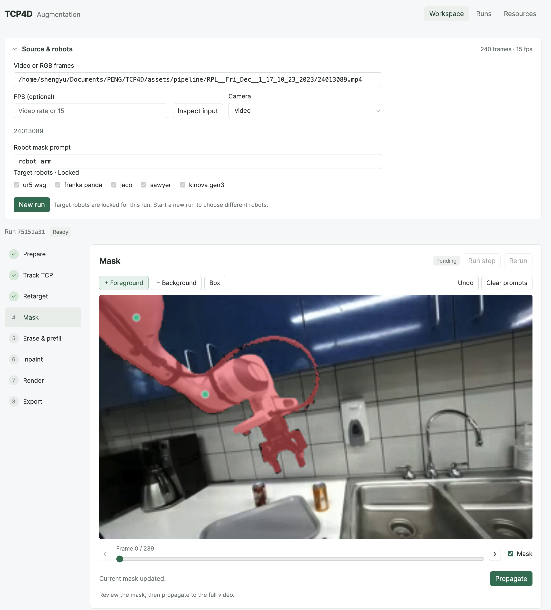
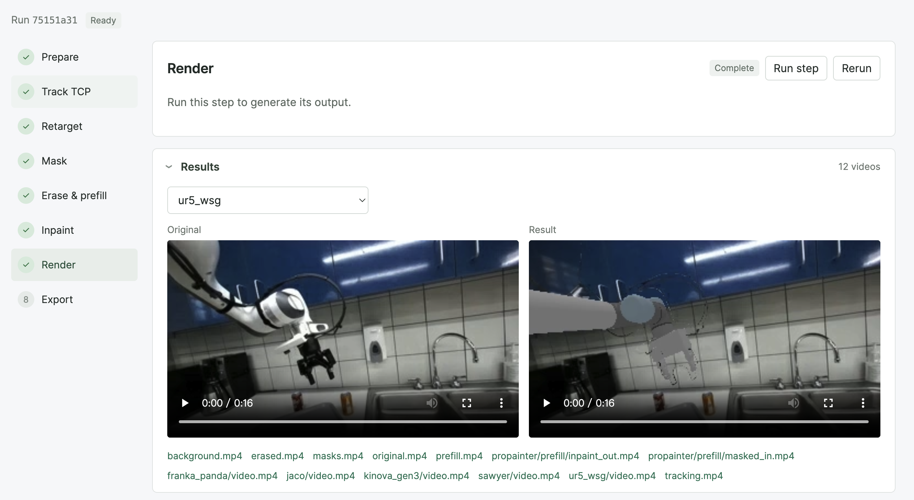

# RGB Video Augmentation

Use an MP4 or RGB sequence to generate videos and motion labels for a target robot. TCP4D predicts TCP poses, gripper states, depth and camera parameters.

## Install

Requires Linux, an NVIDIA GPU, CUDA 12.8 and Vulkan.

```bash
conda create -n tcp4d -c conda-forge python=3.11 nodejs=22 ffmpeg -y
conda activate tcp4d
pip install torch==2.9.1 torchvision==0.24.1 --index-url https://download.pytorch.org/whl/cu128
export CUDA_HOME=/usr/local/cuda-12.8
bash aug_pipeline/install.sh
npm --prefix aug_pipeline/frontend ci
npm --prefix aug_pipeline/frontend run build
```

<div align="center">
  
</div>

## Launch

```bash
cp aug_pipeline/config.example.yaml aug_pipeline/config.local.yaml
hf auth login
# Accept the facebook/sam3.1 access terms before downloading.
tcp4d-aug --config aug_pipeline/config.local.yaml download tcp4d assets sam3 propainter
tcp4d-aug --config aug_pipeline/config.local.yaml web --port 7862
```

Open **http://127.0.0.1:7862**. The example in `assets/pipeline/` is selected automatically.

To download all supported robots:

```bash
tcp4d-aug --config aug_pipeline/config.local.yaml download assets --arms ur5_wsg franka_panda jaco sawyer kinova_gen3
```

## Use

1. Select target robots and click **Create run**. In **Track TCP**, click the initial TCP in frame zero. The point saves automatically.
2. Run **Track TCP → Retarget → Mask**. Track TCP prepares the RGB input automatically.
3. Review the mask. Add foreground/background points or a box, then click **Propagate**.
4. Run **Erase & prefill → Inpaint → Render → Export**.
5. Review the result and download **dataset.zip**.

For your own input, add its parent directory to `data_roots` in `config.local.yaml`, select an MP4 or RGB frame directory and click **Inspect input**. RGB sequences default to 15 fps; change **FPS** when needed. No depth, calibration or robot state files are needed.

Results are saved under `aug_pipeline/work/jobs/<id>/`. The ZIP contains images, target joint states/actions, TCP poses, timestamps and predicted camera parameters.

Each target robot uses one arm and one IK trajectory, stored in the `left` slot. Rendering and export use that same trajectory. Runs created with the previous dual-slot format must rerun **Retarget → Render → Export**.

During **Retarget**, if IK fails at the target robot's initial base placement, the pipeline automatically searches nearby robot-base translations and retries IK over the full trajectory (`auto_base` is enabled by default). The base orientation remains fixed during this search, and the target arm is accepted only when every frame passes IK. For further details on robot-base adjustment in cross-embodiment augmentation, refer to the [OXE-AugE paper and project page](https://oxe-auge.github.io/).


<div align="center">
  
</div>